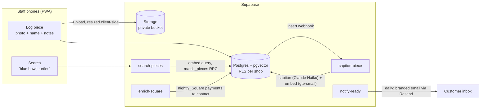

# SpottySearch

**Find a customer's pottery by describing it.** A production logging and retrieval app for a paint-your-own pottery café, built on vision-language captioning, vector search and Postgres row-level security.

Live at [spottysearch.co.uk](https://spottysearch.co.uk) (staff login required), in use at Spotty Pots.

---

## The problem

At a paint-your-own pottery café, every painted piece is photographed before it goes into the kiln and collected days or weeks later. Until now that meant posting each photo to a staff WhatsApp group with the customer's name. When a customer came back, someone scrolled through hundreds of photos looking for "Sarah, the blue bowl with turtles". If the name was misspelt, forgotten or buried weeks back, the search failed.

SpottySearch replaces that with two things:

1. **A logging app** on staff phones: photo, customer name, item count, optional notes.
2. **A search page** at the counter: type what the customer describes (*"white mug with a caterpillar"*) and get the matching photos ranked, then mark the piece collected in one tap.

Around those sit the things a real shop needed: automatic "your pottery is ready" emails, an owner dashboard, chase-up emails for uncollected pieces, per-shop data isolation and GDPR anonymisation.

## How it works



- **Upload:** the PWA resizes the photo to 1280px on the phone, uploads it to a private bucket and inserts a row. It queues in IndexedDB if the shop's signal drops.
- **Caption:** a database webhook triggers an edge function. Claude Haiku describes every item in the photo (colour, form, painted patterns, any text) and is told to ignore background clutter. The caption, plus any staff notes, is embedded with `gte-small` (384-d) and stored in pgvector.
- **Search:** the query is embedded the same way and ranked by cosine similarity in a `match_pieces` RPC (HNSW index). A keyword hit on staff notes adds a small score boost, so pieces can be found by notes alone. The RPC runs as the caller, so RLS scopes results to their shop automatically.
- **Learning loop:** each time a searched-for piece is confirmed, the query, the chosen piece and its rank are logged as labelled data for future evaluation and fine-tuning.

## Why captions, not CLIP

Before building anything I ran an offline comparison on real shop photos (the notebooks in this repo). There were 20 hand-labelled queries over a pool of 43 photos, and each method ranked every photo for every query.

| Method | recall@1 | recall@3 | recall@5 | MRR | Median rank |
| --- | --- | --- | --- | --- | --- |
| CLIP ViT-B/32 (image ↔ text) | 0.45 | 0.65 | 0.70 | 0.60 | 2 |
| **VLM caption → text embedding** | **0.60** | **0.80** | **0.80** | **0.71** | **1** |

CLIP did well on overall colour and shape but struggled when a query relied on painted text or named designs. Those are exactly what customers remember ("it says *Grandma* on it"). The caption route turns those into searchable words. Its main failure mode was clutter: the 3B local VLM sometimes described background objects as pottery, and one photo dropped to rank 26. That finding went straight into the production prompt as an explicit ignore-the-background instruction.

Caption search also needs no GPU at query time. Captioning happens once, asynchronously at upload, through a vision API, and search is text against text. So the production system dropped CLIP and swapped local Qwen2.5-VL for a hosted model. With only 20 queries these numbers are indicative, not precise.

## Engineering highlights

- **Multi-tenant security in the database, not the app.** Every table and the storage bucket use row-level security keyed on `my_shop_id()`. Owners get read access across their shops through a separate policy, and admin RPCs refuse non-admins. [`supabase/test_rls.sql`](supabase/test_rls.sql) seeds two shops, two workers and one owner, impersonates each through JWT claims and asserts the isolation, all inside a rolled-back transaction.
- **Square enrichment without guessing.** A nightly job matches customer names against Square payments within a ±1-day window, falling back to first-name and containment matching. It only accepts a single unambiguous match: two Sarahs on the same day means no match. Contact capture at the till is incomplete (around half of payments on a sample day), so enrichment is best-effort and never blocks anything.
- **Idempotent notifications.** `notified_at` is written *before* the email is sent, so a retried cron run can't email a customer twice. Ready emails are time-based (14 days after logging) because the shop's real workflow didn't reliably include marking pieces as fired.
- **Offline-tolerant PWA.** It's vanilla JS with no build step. It installs to the home screen, uses a network-first service worker and keeps an IndexedDB queue for uploads made with no signal.
- **Editing that keeps search in sync.** Editing a piece's notes re-embeds caption plus notes server-side, and status edits keep the ready/collected timestamps consistent.
- **Operations.** There's a role-gated owner dashboard (per-shop KPIs, 30-day activity, search top-3 hit rate, an overdue-pieces list with one-click chaser emails), worker self-registration through per-shop join codes, password reset, a nightly `pg_dump` backup through GitHub Actions, and a pg_cron job that anonymises collected pieces after 6 months while keeping the photo and caption for training data.

## Tech stack

| Layer | Tools |
| --- | --- |
| Front end | Vanilla JS PWA, service worker, IndexedDB, Chart.js |
| Backend | Supabase: Postgres 17, pgvector (HNSW), RLS, Storage, Auth, pg_cron |
| Edge functions | Deno / TypeScript: `caption-piece`, `search-pieces`, `update-piece`, `enrich-square`, `notify-ready`, `send-chaser` |
| ML | Claude Haiku 4.5 (captioning), gte-small embeddings; offline eval with CLIP, Qwen2.5-VL-3B, all-MiniLM-L6-v2 |
| Integrations | Square Payments and Customers API, Resend (email) |
| Hosting / ops | Netlify, GitHub Actions |

## Repository layout

```
app/                    PWA: logging (index), search, admin dashboard, edit dialog, password reset
supabase/
  schema.sql            core schema, RLS, storage policies
  phase2…7.sql          migrations: search RPC, Square fields, owner/admin, chasers, notes
  test_rls.sql          tenant-isolation test suite
  functions/            edge functions (one folder each)
.github/workflows/      nightly database backup
evaluation.ipynb        CLIP vs caption retrieval comparison
clip_search.ipynb       CLIP image-index prototype
caption_search.ipynb    Qwen2.5-VL caption prototype
label_images.py         Tkinter tool used to build the labelled eval set
labels.json             hand-written query descriptions for the eval
captions.json           cached prototype captions
PLAN.md, SETUP*.md      build plan and phase-by-phase deployment guides
```

The prototype photos aren't included because they show real customers' work.

## Running it yourself

Each phase has a step-by-step deployment guide: start with [`SETUP.md`](SETUP.md), then `SETUP-PHASE2.md` to `SETUP-PHASE7.md`. You'll need a Supabase project, and for the full feature set an Anthropic API key, a Resend account and optionally a Square developer token. The app itself is static files: point `app/config.js` at your Supabase project and serve the `app/` folder.

## What's next

- Use the logged search confirmations to re-run the eval on real production queries instead of 20 hand-written ones.
- Hybrid ranking (BM25 plus embeddings) for exact-term queries.
- Crop or segment the piece before captioning to remove the remaining background noise.

---

Built by [Joe Smith](https://joe-smith-computer-vision.com) · [LinkedIn](https://linkedin.com/in/joe-smith-phd-08039b190)
